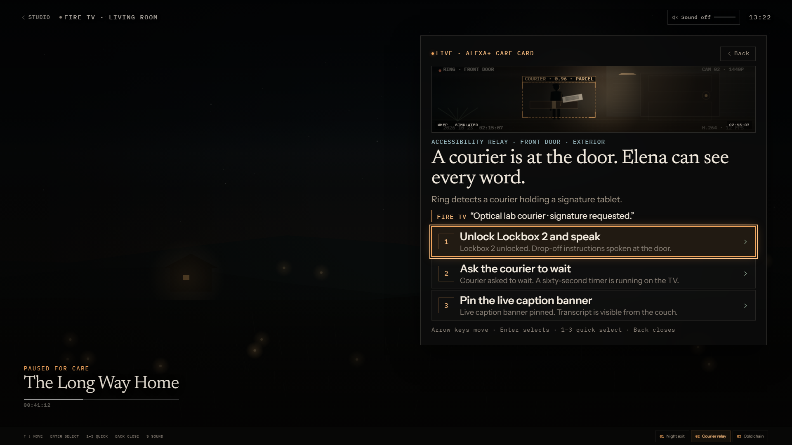

# DESIGN.md — The Night Watch

HearthGuard’s visual direction is **The Night Watch**: a warm, instrument-like care console
that feels like a lamp left on in a quiet house, not a security operations dashboard. The
interface is built from hairlines, editorial type, monospaced telemetry, and one amber
porch-light accent. It is intentionally calm at rest and precise when a threshold event
arrives.

The signature moment is the living-room TV dimming as the amber care card enters. The room
does not go black; it loses contrast so the card becomes the brightest object on screen.



---

## 1. Principles

1. **The room is the interface.** TV type and focus targets are sized for a couch, not a
   laptop. The studio is an observability surface; the TV is the care surface.
2. **One signal colour.** Amber marks the threshold, focus, and active care. Coral is reserved
   for the critical-care severity label; sage marks completion. Colour is never the only cue.
3. **Hairlines, not cards on cards.** Panes are separated by 1 px rules. Surfaces are warm
   charcoal with a faint inner highlight, not floating glass rectangles.
4. **Editorial where a human reads; mono where a machine speaks.** The care narrative uses
   Newsreader. Telemetry, timestamps, protocol names, and key hints use IBM Plex Mono.
5. **Motion explains arrival.** The HUD fades and lifts into place; the room dims behind it.
   Nothing loops for decoration, and reduced-motion users get the final state immediately.
6. **Honesty is part of the visual language.** Integration state is always visible in the
   masthead and provenance footer. Simulated surfaces are labelled as simulated.

---

## 2. Colour tokens

Defined in `src/client/styles/tokens.css`.

```css
:root {
  --bg-0: #070605;
  --bg-1: #0b0a08;
  --bg-2: #100e0b;
  --bg-3: #16120e;
  --surface: rgba(22, 18, 14, 0.72);
  --surface-solid: #15110d;

  --line: rgba(244, 231, 211, 0.1);
  --line-strong: rgba(244, 231, 211, 0.18);

  --ink: #f3ebdf;
  --ink-2: #cdc2b2;
  --ink-3: #a89c8c;
  --ink-4: #8a8177;

  --amber: #f0a45c;
  --amber-bright: #ffc182;
  --amber-deep: #b86f35;
  --amber-soft: rgba(240, 164, 92, 0.12);

  --sage: #9bb7a1;
  --ok: #8fb59a;
  --cool: #9fc0c7;
  --coral: #e08a6f;

  --focus: #ffc182;
}
```

The page background is not flat black. It is a fixed stack of warm charcoal gradients with a
subtle SVG noise overlay at 4.5% opacity. The warm radial glow at the top right is the
“porch light” and is never used as a status indicator.

### Contrast

Measured against `#0b0a08`:

| Token | Ratio |
| --- | ---: |
| `--ink` | 16.74:1 |
| `--ink-2` | 11.27:1 |
| `--ink-3` | 7.35:1 |
| `--ink-4` | 5.17:1 |
| `--amber` | 9.58:1 |
| `--amber-bright` | 12.44:1 |
| `--coral` | 7.57:1 |
| `--sage` | 9.12:1 |

All core ink tokens pass WCAG AA for normal text on the console surface. This is not a
blanket AAA claim, and no automated accessibility certification is included. Note that
`--ink-4` is the floor at 5.17:1; do not use it for smaller or lower-contrast contexts than
the current console.

A `prefers-contrast: more` media query raises the hairlines and lightens `--ink-3` /
`--ink-4`.

---

## 3. Typography

| Role | Face | Usage |
| --- | --- | --- |
| Display / narrative | **Newsreader Variable** | Care titles, spoken Alexa+ text, thesis line |
| UI / body | **Instrument Sans Variable** | Labels, buttons, summaries, controls |
| Telemetry | **IBM Plex Mono** | Protocol names, timestamps, keys, badges, timeline metadata |

The type scale is fluid rather than a fixed ladder:

- thesis line: `clamp(17px, 1.5vw, 22px)`, weight 330;
- reading title: large editorial serif with tight leading;
- Fire TV card title: `clamp(30px, 2.6vw, 48px)`, line-height 1.02;
- Fire TV action label: `clamp(16px, 1.35vw, 26px)`;
- Fire TV summary/caption: `clamp(15px, 1.1vw, 21px)`;
- eyebrow / key hint: mono, uppercase, tracked.

Mono is never used for long prose. Serif is never used for controls or numbers that need to
align.

---

## 4. Studio layout

The studio is a single editorial page, max-width **1760 px**, with 30 px side padding.

```text
┌──────────────────────────────────────────────────────────────┐
│ Masthead: brand · live status · MCP/HMAC/Nova/session · scenarios · sound · Fire TV │
├──────────────────────────────────────────────────────────────┤
│ Thesis strip: “Ring sees. Bee remembers. Nova reasons…”      │
├──────────────────┬──────────────────┬────────────────────────┤
│ Threshold        │ Reading          │ Living Room            │
│ Ring / WHEP      │ care narrative   │ TV preview + actions   │
│ signed event     │ evidence + actions│ + remote              │
├──────────────────┴──────────────────┴────────────────────────┤
│ Ledger: MCP wire                          Care timeline       │
├──────────────────────────────────────────────────────────────┤
│ Provenance footer: integration state + “What is simulated”    │
└──────────────────────────────────────────────────────────────┘
```

- **Masthead** (`min-height: 78px`, sticky): brand, connection state, protocol chip, HMAC
  state, Nova live/replay chip, short MCP session id, three scenario buttons, room-tone
  toggle, and a Fire TV link.
- **Thesis strip**: one serif sentence plus a mono meta line. It states the product logic
  before the interface asks for attention.
- **Console grid**: three panes with `minmax()` tracks:
  `0.92fr / 1.08fr / 1.3fr`, minimums `280 / 340 / 430 px`. The living room gets the most
  space because it contains the care card.
- **Threshold pane**: procedural camera canvas, zone, device, WHEP state, signed event
  evidence, and captions.
- **Reading pane**: severity, narrative, Bee memory, evidence grid, Alexa+ spoken line, action
  deck. This is the human-readable explanation of why the card exists.
- **Living Room pane**: a TV bezel with a 16:9 screen, the compact HUD, an `ActionDeck`, and a
  remote control. The studio uses the compact card; the full 10-foot card is reserved for
  Fire TV mode.
- **Ledger**: MCP JSON-RPC wire on the left (`1.35fr`) and care timeline on the right (`1fr`).
  The wire is capped at 60 entries in the client; the timeline is capped at 120 entries on
  the server.
- **Provenance footer**: always-visible capability dots plus a disclosure panel listing what
  is simulated. This is a design requirement, not a legal afterthought.

### Responsive behavior

| Breakpoint | Change |
| --- | --- |
| `≤ 1500px` | Masthead tightens; scenario labels lose some meta |
| `≤ 1280px` | Masthead becomes two rows; console becomes two columns (threshold + reading, living room below) |
| `≤ 980px` | Single-column console and ledger; masthead stacks; TV preview remains 16:9 |
| `≤ 720px` | Mobile type and spacing; wire rows reflow; scenario controls wrap |
| `≤ 900px` (Fire TV card) | HUD shifts to a wider, lower card; summary may be hidden to preserve action space |

The smallest supported width is 320 px. The page has no horizontal-scroll design.

---

## 5. Fire TV / 10-foot surface

`?mode=firetv` renders `FireTvPage` — a full-viewport TV surface with no studio chrome.

- **Stage**: full `100vw × 100vh`; the simulated film surface is canvas/CSS, not a real
  `<video>` element.
- **HUD placement**: absolute, `top: 8vh`, `right: 3.2vw`, width
  `min(46vw, 840px)`, max-height `84vh`, internal scroll only if the card exceeds the screen.
- **HUD structure**: status tag, Back control, simulated camera feed with
  `WHEP · SIMULATED` or `LIVE WHEP` badge, severity/zone eyebrow, title, first summary
  sentence, rotating caption, three full-width action rows, and either a result panel or the
  keyboard hint.
- **Action rows**: `min-height: clamp(58px, 6.8vh, 76px)`, numeric key cap, action label and
  outcome, state icon. Focus raises an amber 1 px ring plus a soft glow.
- **Typography**: title up to 48 px, actions up to 26 px, summary up to 21 px. This is sized
  for roughly 10 feet, not for a desktop monitor.
- **Chrome**: source label (“Fire TV · living room”), sound level, clock, and a Studio link.
  The film strip below shows a title and progress; it pauses when the card arrives.
- **Keyboard hint**: `↑ ↓ move`, `Enter select`, `1–3 quick`, `Back close`, `S sound`.
  `F` toggles browser fullscreen but is not printed in the hint row.

### Focus behavior

- The first action receives focus **320 ms** after the card mounts, but only if the viewer
  has not already focused a control outside the HUD.
- Arrow keys wrap through the three actions. `1`–`3` focus and execute immediately.
- `Enter` activates the focused native button. The global handler deliberately does not
  hijack Enter when a native control already has focus.
- `Escape` / `Backspace` closes the card and resolves the incident.
- In the studio, D-pad keys only act while focus is inside the living-room panel. On the Fire
  TV surface they are global.

This is a browser simulation of a TV surface. No Vega OS manifest, device package, or
hardware remote is included.

---

## 6. Motion

Motion is implemented with GSAP in `TvStage.tsx`, with explicit reduced-motion handling.

| Moment | Motion |
| --- | --- |
| HUD arrival | opacity + `y` (16 px studio / 30 px TV) + scale `0.975 → 1`, `0.62 s`, `power3.out` |
| HUD content reveal | staggered opacity + 12 px rise, `0.5 s`, `0.07 s` stagger, `0.18 s` delay, `power2.out` |
| Room dim | opacity `0 → 1`, `0.6 s`, `power2.out` |
| Room tone | WebAudio gain ramp, ~1.4 s start, ~0.9 s duck transitions |
| HUD exit | 460 ms hold before unmount; the card is removed without a spring |

`prefers-reduced-motion: reduce` skips the GSAP entrance and sets the dim layer directly to
its final opacity. CSS also collapses animation and transition durations globally.

No FPS target is claimed. The animations use transform/opacity and the canvas is procedural,
but the project has not been profiled on TV hardware.

---

## 7. Audio

`src/client/lib/roomTone.ts` generates a six-second brown-noise buffer plus a 58 Hz sine hum.
Nothing is streamed or licensed. Audio starts only after a user gesture, per browser autoplay
rules.

- Base gain: `0.07`
- Ducked gain: `0.012`
- The UI reports `100%` / `20%`; the underlying gain ratio is lower than 20%.
- The sound toggle exists in the masthead and on the TV surface. `S` toggles it in Fire TV
  mode.

The “audio ducking” is therefore a real WebAudio gain change on generated room tone, not a
claim about a real TV’s media volume.

---

## 8. Component language

- **Chips** are mono, uppercase, 1 px bordered, with a small status dot where relevant.
- **Buttons** use a 1 px border and a subtle warm fill on hover/focus; the primary care action
  is amber, secondary actions are neutral.
- **Action deck** rows use a numeric key cap, a short label, and an outcome line. Completed
  rows get a check; busy rows get a spinner.
- **Wire rows** are a fixed grid: time, direction dot, method, detail, status, latency.
  Direction is encoded by both colour and a text glyph.
- **Timeline rows** use a kind marker, time, title, and detail. The newest entry is visually
  first; there is no infinite scroll.
- **Toasts** sit above the footer, use a live region, and auto-dismiss after 4.6 s.

---

## 9. Accessibility notes

- A skip link jumps to the care console.
- The studio has a `main` landmark, labelled ledgers, and labelled status groups.
- Buttons have visible focus rings (`2 px` amber, `3 px` offset); the TV card adds a second
  glow ring.
- Native buttons are used for actions, so Enter/Space and screen-reader activation work.
- Dynamic results use `role="status"` / `aria-live="polite"`; errors use `role="alert"`.
- The camera canvas is decorative and the narrative carries the same information in text.
- Captions rotate every 4.8 s in the full HUD; the first caption is always present in text.
- `prefers-reduced-motion` and `prefers-contrast: more` are honored.

Known gaps: no formal screen-reader certification, no automated axe run, and no user testing
with care recipients. Those are listed in [RESULTS.md](RESULTS.md).

---

## 10. What this design is not

- It is not a security-operations dashboard. There are no dense red alerts, siren colours, or
  always-on surveillance grids.
- It is not a medical device interface. It does not diagnose, prescribe, or replace a
  caregiver.
- It is not a shipped Fire TV app. It is a browser-based 10-foot surface built to demonstrate
  the interaction model.
- It is not glassmorphism for its own sake. The TV card uses a dark translucent surface and a
  blur only where it must sit over moving content.
