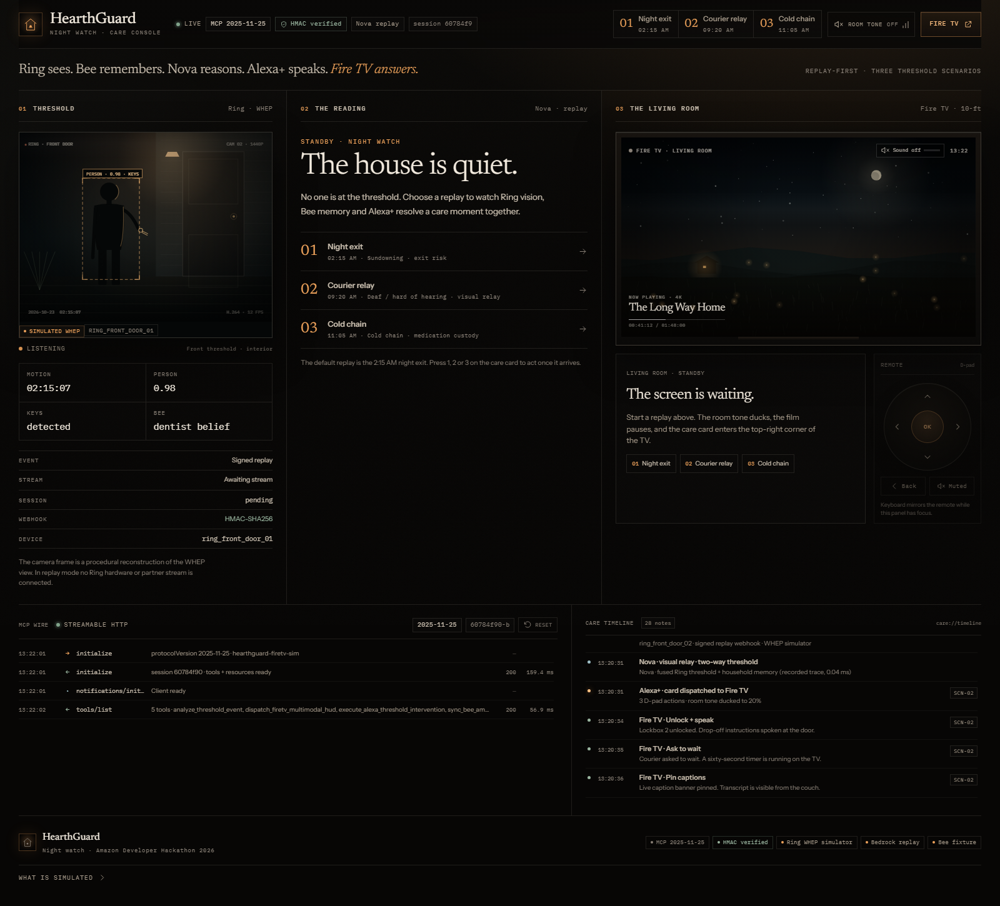

# HearthGuard (KinSight)

**A cross-device care concierge for the moments a normal smart-home alert is too late.**

HearthGuard connects a Ring-style threshold event, spoken household memory, an Alexa+ MCP
server, AWS Bedrock Nova, and a 10-foot Fire TV care card into one calm intervention loop.
The demo is built around one fictional household and three threshold scenarios. The protocol
work is real; the camera frames and household are not.



---

## What it is

- **One care loop, not five dashboards.** A threshold event becomes a reasoned care card,
  three remote-friendly actions, and a written care note.
- **Built for the room, not the phone.** The Fire TV surface is designed for a viewer on a
  couch: large type, high contrast, numeric shortcuts, and D-pad focus that is always visible.
- **Replay-first.** With no cloud credentials the app runs a deterministic, signed local
  replay. Live Ring, Bee, and Bedrock paths exist but are optional.

The console uses an editorial “Night Watch” language: warm charcoal, hairlines, a serif
reading pane, monospaced telemetry, and a single amber porch-light accent.

---

## What is live and what is simulated

This table is the honest boundary. It also appears in the app’s **What is simulated** footer.

| Surface | Default (no credentials) | With configuration |
| --- | --- | --- |
| Ring webhook contract | HMAC-SHA256 signing and verification, 300-second replay window | Same code path; set `RING_WEBHOOK_SECRET` |
| Ring WHEP | Deterministic SDP loopback; the camera image is procedural canvas art | Calls a WHEP endpoint when `RING_OAUTH_TOKEN` is set. Live partner access is **not verified** by this repo. |
| Alexa+ MCP | Real MCP SDK server over Streamable HTTP, protocol `2025-11-25` | Same server; no Alexa+ cloud registration is included |
| AWS Bedrock | Recorded spoken response and deterministic care card | Nova generates the spoken sentence when AWS credentials and model access exist; the card/action structure stays deterministic |
| Bee memory | Recorded household fixture | Queries `BEE_PROXY_URL` with a 400 ms timeout, then falls back |
| Fire TV | Browser simulation of a 10-foot HUD | Same browser surface; no physical Fire TV or Vega OS package is included |
| Room tone | Generated in the browser with WebAudio | Same; audio starts only after a user gesture |

No real camera stream, Echo device, Fire TV device, or Alexa+ account is invoked. The masthead’s
**HMAC verified** chip means the local secret is configured (and, after a replay, that the
self-check passed); it does not mean a live Ring event was received. See
[SECURITY.md](SECURITY.md) and the in-app provenance panel for the full disclosure.

---

## Quick start

Requirements: **Node.js 20+** (verified on Node 24.22.1) and npm.

```bash
npm install
npm run dev
```

Open **http://localhost:5173**. The server listens on **http://localhost:4000** and exposes
MCP at **http://localhost:4000/mcp**.

The studio auto-runs `SCN-01` about 850 ms after load. Useful URLs:

| URL | Behavior |
| --- | --- |
| `http://localhost:5173/` | Studio, auto-runs the night-exit scenario |
| `http://localhost:5173/?empty=1` | Studio at rest; choose a scenario yourself |
| `http://localhost:5173/?scenario=SCN-02` | Studio, auto-runs the courier relay |
| `http://localhost:5173/?scenario=SCN-03` | Studio, auto-runs the cold-chain scenario |
| `http://localhost:5173/?mode=firetv` | Fullscreen 10-foot Fire TV surface |
| `http://localhost:5173/?mode=firetv&scenario=SCN-02` | Fire TV surface with a specific card |

Production build:

```bash
npm run build
npm start
```

`npm run build` type-checks and writes `dist/`. `npm start` serves the API, MCP endpoint,
and the built client from the same Express process on `:4000`.

---

## The three thresholds

| ID | Moment | Resident | What HearthGuard does |
| --- | --- | --- | --- |
| `SCN-01` | **02:15 AM** — Arthur is at the door with his keys | Arthur, 78 | Bee remembers a dentist belief that conflicts with the calendar. Alexa+ offers a calm redirect, a caregiver check-in, or a night latch. |
| `SCN-02` | **09:20 AM** — a courier needs a signature | Elena, Deaf / hard of hearing | The TV ducks, pins a visual intent card, and offers Lockbox 2, a 60-second wait, or pinned live captions. |
| `SCN-03` | **11:05 AM** — insulin sits in direct sun | Arthur, 78 | The porch reads 34°C and the clinic’s 20-minute cold-chain window is known. The card offers a 4°C lockbox, a trusted neighbour, or an immediate porch pickup. |

All names, quotes, timestamps, and household details are fictional and deterministic.

---

## The demo in one pass

1. Open the studio at `?empty=1`.
2. Choose **Night exit** in the reading pane, or one of the three scenario buttons in the masthead.
3. Watch the threshold pane, reading pane, and living-room TV update together.
4. Press a care action (or `1`–`3` while the TV panel has focus).
5. Read the Alexa+ response and outcome in the card and the care timeline.
6. Press **Close the care card** (or `Escape` while the TV panel has focus) to write the care
   note and return the house to quiet.
7. Open **Fire TV** for the full 10-foot surface. The HUD takes focus after 320 ms.

Fire TV controls:

| Key | Action |
| --- | --- |
| `↑` `↓` `←` `→` | Move focus (wraps through the three actions) |
| `Enter` | Activate the focused action |
| `1` `2` `3` | Focus and execute that action immediately |
| `Escape` / `Backspace` | Close the card and resolve the incident |
| `S` | Toggle the generated room tone |
| `F` | Enter or leave browser fullscreen |

---

## How it works

```text
Ring-style event
      │  HMAC-SHA256 + 300 s replay window
      ▼
Express API ──────────────► care engine ──────────────► SSE /api/events
      │                         │                              │
      │                         ├─ Bee memory (proxy/fixture)  │
      │                         ├─ Bedrock Nova (live/replay)  │
      │                         └─ bounded timeline            │
      │                         │                              ▼
      └─ MCP /mcp ◄────────────┘                     React studio + TV
         Streamable HTTP 2025-11-25                  3-pane console + HUD
```

The browser client opens a stateful MCP session, calls `tools/list`, and uses
`tools/call` for every care action and resolution. The REST API is used for replay control,
state, timeline, and the live event stream.

---

## MCP surface

Protocol: **`2025-11-25`** via `@modelcontextprotocol/sdk` `StreamableHTTPServerTransport`.
Transport: `POST`, `GET`, and `DELETE /mcp` with `Mcp-Session-Id`. POST responses use JSON
(`enableJsonResponse: true`); GET is used for the server-to-client stream.

### Tools

| Tool | What it does |
| --- | --- |
| `analyze_threshold_event` | Processes a scenario, fuses Bee memory and the reasoning trace, returns text plus the care-card resource |
| `dispatch_firetv_multimodal_hud` | Ensures an incident exists, publishes `hud.dispatched`, and returns the card |
| `execute_alexa_threshold_intervention` | Runs one card action, publishes the intervention, and returns the Alexa+ spoken response |
| `sync_bee_ambient_context` | Reads a Bee fact from the configured proxy or the recorded fixture |
| `resolve_care_incident` | Closes an incident with an optional note and writes the timeline |

### Resources

| URI | Contents |
| --- | --- |
| `care://timeline` | The bounded in-memory care log |
| `care://scenarios` | The three scenario definitions and actions |
| `care://household` | Fictional household members and device ids |

The card is returned as an MCP embedded resource with the demo media type
`application/vnd.alexa.mcp.card+json`. This is a local envelope used by the UI, **not an
official Alexa+ card schema**.

Minimal client flow:

```bash
# 1. Initialize and keep the returned Mcp-Session-Id
curl -i -s http://localhost:4000/mcp \
  -H "Content-Type: application/json" \
  -H "Accept: application/json, text/event-stream" \
  -d '{"jsonrpc":"2.0","id":1,"method":"initialize","params":{"protocolVersion":"2025-11-25","capabilities":{},"clientInfo":{"name":"curl","version":"1.0.0"}}}'
```

```bash
# 2. Call a tool with that session id
curl -s http://localhost:4000/mcp \
  -H "Content-Type: application/json" \
  -H "Accept: application/json, text/event-stream" \
  -H "MCP-Protocol-Version: 2025-11-25" \
  -H "Mcp-Session-Id: <session-id>" \
  -d '{"jsonrpc":"2.0","id":2,"method":"tools/call","params":{"name":"execute_alexa_threshold_intervention","arguments":{"scenarioId":"SCN-01","actionId":"calm_redirect"}}}'
```

After initialization, send `notifications/initialized` before other requests, as the browser
client does in `src/client/lib/useHearthGuard.ts`.

---

## HTTP API

| Method | Path | Purpose |
| --- | --- | --- |
| `GET` | `/api/health` | Service version, time, and capability report |
| `GET` | `/api/state` | Incidents, timeline, capabilities, server time |
| `GET` | `/api/timeline` | The care timeline |
| `GET` | `/api/scenarios` | Scenario definitions |
| `POST` | `/api/demo/trigger/:id` | Signed replay path; disabled when `DEMO_MODE=false` |
| `POST` | `/api/demo/reset` | Clear in-memory incidents and timeline; disabled when `DEMO_MODE=false` |
| `POST` | `/api/ring/webhook` | HMAC-verified Ring-style ingestion |
| `GET` | `/api/events` | Server-sent events for the UI |

`/api` uses permissive CORS for local development. `/mcp` allows only `localhost` /
`127.0.0.1` origins plus an optional `MCP_ALLOWED_ORIGIN`, and exposes
`Mcp-Session-Id` to browser JavaScript.

---

## Project layout

```text
src/
  client/
    App.tsx                 Three-pane studio
    FireTvPage.tsx          Fullscreen 10-foot surface
    components/             Masthead, panes, HUD, camera canvas, wire, timeline
    lib/                    API, SSE/MCP client, room tone, D-pad navigation
    styles/                 Night Watch tokens and layout
  server/
    app.ts                  Express routes, webhook ingestion, static build
    mcp.ts                  MCP tools, resources, Streamable HTTP handlers
    careEngine.ts           Incident lifecycle and capability report
    scenarios.ts            The three deterministic scenarios
    bedrockStrandsAgent.ts  Optional Nova call + recorded trace
    beeContextClient.ts     Optional Bee proxy + fixture
    timeline.ts             Bounded in-memory care log
  shared/types.ts           Shared contracts
packages/
  ring-alexa-mcp-bridge/    Standalone MIT package: HMAC, WHEP, card payload
docs/                       Screenshots used by the README and design doc
tests/                      Vitest unit and protocol tests
e2e/                        Playwright studio and Fire TV flows
```

---

## Commands

| Command | What it runs |
| --- | --- |
| `npm run dev` | Express (`:4000`) + Vite (`:5173`) together |
| `npm run dev:server` | Server with `tsx watch` |
| `npm run dev:client` | Vite only |
| `npm run build` | `tsc --noEmit` + production Vite build |
| `npm start` | Server on `:4000`, serving `dist/` if present |
| `npm test` | Vitest: 4 files, 19 tests |
| `npm run test:bridge` | Bridge package tests only |
| `npm run test:agent` | Reasoning/fallback tests only |
| `npm run test:mcp` | MCP protocol tests only |
| `npm run test:e2e` | Playwright: 3 browser flows on isolated ports `4100` / `5273` |

The E2E run starts its own server and Vite instance, so tabs left open on the normal dev
server cannot create incidents behind the test.

---

## Configuration

Copy `.env.example` to `.env` if you want to change defaults. All live integrations are
optional.

| Variable | Default | Effect |
| --- | --- | --- |
| `PORT` | `4000` | Express port |
| `DEMO_MODE` | `true` | When `false`, disables `/api/demo/trigger` and `/api/demo/reset` |
| `RING_WEBHOOK_SECRET` | local demo secret | HMAC secret; **change it for anything exposed** |
| `RING_API_BASE_URL` | `https://api.amazonvision.com` | WHEP base URL |
| `RING_OAUTH_TOKEN` | unset | Enables the live WHEP attempt; falls back to loopback on failure |
| `BEE_PROXY_URL` | unset | Bee-compatible facts endpoint; query receives `?scenario=SCN-0x` |
| `AWS_REGION` | `us-east-1` | Bedrock region |
| `BEDROCK_MODEL_ID` | `amazon.nova-pro-v1:0` | Bedrock model id |
| `AWS_ACCESS_KEY_ID` / `AWS_SECRET_ACCESS_KEY` | unset | Enables the live Nova attempt |
| `MCP_ALLOWED_ORIGIN` | unset | Extra browser origin allowed to call `/mcp` |
| `VITE_API_TARGET` | `http://localhost:4000` | Vite proxy target; used by E2E |

The live WHEP and Bedrock paths are implemented but **not validated against partner
credentials in this repository**. If a live call fails, the server falls back rather than
breaking the demo.

---

## Verification snapshot

Measured on Node **24.22.1**, npm **11.5.2**, Windows:

| Check | Result |
| --- | --- |
| `npm test` | **4 files / 19 tests passed** (3.83 s) |
| `npm run build` | **passed**; 47 modules; JS 363.27 kB (117.03 kB gzip); CSS 49.13 kB (10.29 kB gzip) |
| `npm run test:e2e` | **3 tests passed** (28.4 s); studio replay, Fire TV D-pad + Enter + Back, number-key quick select |
| Type check | `tsc --noEmit` passed as part of the build |

The E2E tests also assert **zero console/page errors** in the studio flow and the Fire TV
flow. There is no FPS benchmark and no blanket WCAG AAA claim. Core ink tokens measure
**5.17:1–16.74:1** against `#0b0a08`, which supports WCAG AA for normal text on that
surface. See [RESULTS.md](RESULTS.md) and [TEST.md](TEST.md).

---

## Open-source bridge

`packages/ring-alexa-mcp-bridge` is a standalone, dependency-free MIT package with:

- constant-time HMAC-SHA256 verification over `<timestamp>.<raw body>`;
- RFC 8829-style WHEP offer/answer negotiation with a deterministic loopback;
- the Alexa+ MCP card payload helper.

```bash
npm run test:bridge
```

It is not published to npm and is **not an official Amazon or Ring SDK**. See
[packages/ring-alexa-mcp-bridge/README.md](packages/ring-alexa-mcp-bridge/README.md).

---

## Documentation

- [ARCHITECTURE.md](ARCHITECTURE.md) — runtime topology, state, protocols, failure modes
- [DESIGN.md](DESIGN.md) — Night Watch tokens, layout, motion, Fire TV and accessibility
- [PRD.md](PRD.md) — product brief, as-built requirements, non-goals
- [TECH_STACK.md](TECH_STACK.md) — installed dependencies and configuration
- [TEST.md](TEST.md) — test inventory and how to run it
- [RESULTS.md](RESULTS.md) — measured verification results and requirement traceability
- [WORKFLOW.md](WORKFLOW.md) — development, demo, and release workflow
- [SECURITY.md](SECURITY.md) — threat model, controls, and known gaps
- [SUBMISSION_AND_FRICTION_LOG.md](SUBMISSION_AND_FRICTION_LOG.md) — submission copy and observed friction
- [PLAN.md](PLAN.md) — build plan, decisions, and remaining work

---

## Limits

- This is a hackathon reference implementation, not a medical device or an emergency service.
- It does not place calls, unlock real locks, or control real lights. Actions are simulated and
  logged.
- Incidents and timeline entries live in memory and disappear on restart.
- The MCP server has no authentication or rate limiting. Keep it on localhost.
- The Fire TV surface is a browser simulation; there is no Vega OS manifest or device package.
- Live Ring and Bedrock paths are optional and unverified against production partner access.

If you build on this, start with [SECURITY.md](SECURITY.md) before exposing any port.

---

## License

MIT. See [LICENSE](LICENSE). The household, quotes, and scenarios are fictional.
